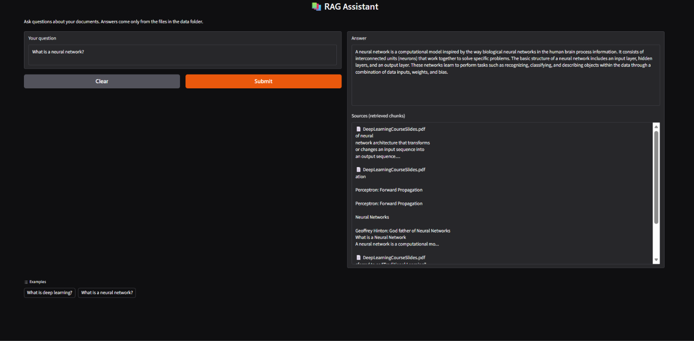
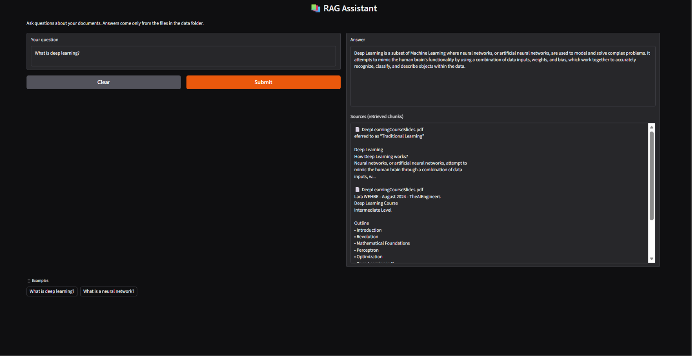

# RAG-Powered Assistant for PDF and Text Search
A small app that answers questions from your own PDF and text files using **Retrieval-Augmented Generation (RAG)**. It runs fully locally and for free: no API key, no GPU.

## 🎯 Project Goal

Large language models don't know the contents of your private documents, and they can make up answers. The goal of this project is to build an assistant that **answers questions only from a set of documents**, by combining a vector database with a local LLM.

The pipeline: **embed → store → retrieve → generate**.

What I wanted to learn and show:

- How retrieval improves the answers of an LLM
- How to combine embeddings with a vector database
- How to work with real data (PDF files)
- How to put open-source tools together into a complete AI application

## 🛠️ What I Did

I built the whole pipeline from scratch in plain Python, without a RAG framework, so that every step is visible in the code.

| Step | What I did | File |
|------|------------|------|
| 1. Load | Read every `.pdf` (with PyMuPDF) and `.txt` file in the `data/` folder | `ingest.py` |
| 2. Split | Cut each document into chunks of 500 characters with a 100-character overlap, so meaning is not lost at the edges | `ingest.py` |
| 3. Embed | Converted each chunk into a vector with `sentence-transformers` (`paraphrase-multilingual-MiniLM-L12-v2`, supports Arabic and English) | `ingest.py` |
| 4. Store | Saved the chunks, vectors and source file names in a ChromaDB database | `ingest.py` |
| 5. Retrieve | Embedded the user's question and fetched the 3 closest chunks from ChromaDB | `rag.py` |
| 6. Generate | Built a prompt with the retrieved context and sent it to a local LLM (`qwen2.5:3b` through Ollama), which is told to answer **only** from that context | `rag.py` |
| 7. Interface | Built a Gradio web page that shows the answer and the source chunks | `app.py` |

My test documents were two PDFs about agentic AI (`agentic automation.pdf` and `llm agent architecture.pdf`).

## 🧱 Tech Stack

- **Language:** Python
- **PDF reading:** PyMuPDF
- **Embeddings:** sentence-transformers
- **Vector store:** ChromaDB
- **LLM:** Ollama with `qwen2.5:3b`
- **UI:** Gradio

## ⚙️ Setup

1. Install [Ollama](https://ollama.com) and download the model:

   ```bash
   ollama pull qwen2.5:3b
   ```

2. Create a virtual environment and install the libraries:

   ```bash
   python -m venv venv
   venv\Scripts\activate        # Windows
   # source venv/bin/activate   # Mac/Linux
   pip install -r requirements.txt
   ```

3. Put your own `.pdf` or `.txt` files in the `data/` folder.

## ▶️ Usage

```bash
python ingest.py    # build the vector database (run once, and again after adding files)
python app.py       # start the web app at http://127.0.0.1:7860
```

You can also test in the terminal with:

```bash
python rag.py
```

## 📸 Sample Questions and Output

### 1. A question answered from the documents

**Question:** What is the main idea in agentic? Give me the main points in these articles.


The answer is generated from the retrieved chunks, and the sources panel shows which PDF each chunk came from.
## Sample questions and output

**Question:** What is a neural network?


**Question:** What is deep Learning?



The assistant replies that it could not find this in the documents instead of guessing.

## 📁 Project Structure

```
Rag-assisstant/
├── data/              # your PDF and text files
├── screenshots/       # sample outputs
├── ingest.py          # load, split, embed, store
├── rag.py             # retrieve and generate
├── app.py             # Gradio interface
├── requirements.txt
└── README.md
```

## 📝 Notes and Limitations

- Developed and tested on a laptop with **16 GB RAM and no GPU**. Answers take a few seconds because the model runs on the CPU.
- The text is split by character count, so a chunk can start in the middle of a word. This does not affect the answers much, but splitting by sentence would be cleaner.
- Scanned PDFs (images of text) are not supported because they need OCR.
- A small 3B model can occasionally ignore the "answer only from the context" instruction.

## 🚀 Ideas for Improvement

- Split text by sentences or paragraphs
- Try a larger model such as `qwen2.5:7b`
- Add OCR support for scanned PDFs
- Add a LangChain version of the pipeline